<div align="center">

<a href="https://abrarayman27.github.io/Abrar_UI-UX_portfolio/">
  
</a>

<br />

[](https://abrarayman27.github.io/Abrar_UI-UX_portfolio/)
[](https://www.behance.net/abrarayman2)
[](https://www.linkedin.com/in/abrar-ayman)

### A portfolio that behaves like the design system behind it.

<sub>One self-contained HTML file · no framework · no build step · every pixel reads from a named token</sub>


</div>

## ⚡ See it move

<div align="center">
  <a href="https://abrarayman27.github.io/Abrar_UI-UX_portfolio/">
    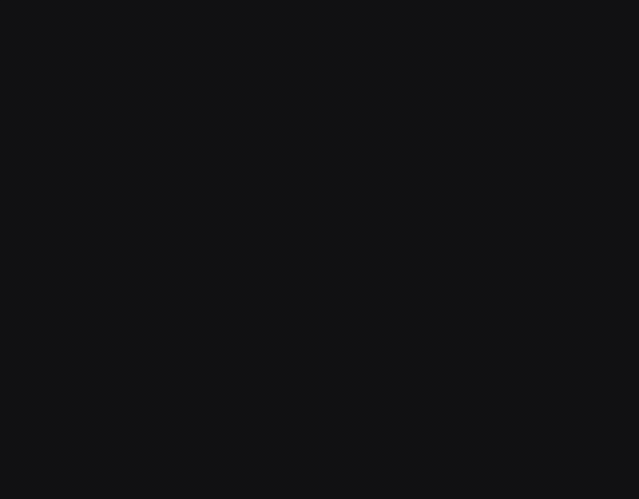
  </a>
  <br />
  <sub>A real screen recording of the site (cursor shown). <b>Click it to play with the real thing.</b></sub>
</div>

<br />

## 🎮 Try it in 30 seconds

This README can't run JavaScript, but the site can. Open the [live site](https://abrarayman27.github.io/Abrar_UI-UX_portfolio/) and try:

| # | Do this | What happens |
|---|---------|--------------|
| 1 | **Hover (or tap) the letters** of my name | Each letter picks a new hue from the palette |
| 2 | Press <kbd>1</kbd> → <kbd>5</kbd> | Opens a token tool: **Colour · Type · Spacing · Radius · Opacity** |
| 3 | Drag the **Radius** slider | The whole page re-rounds, because every card, chip and button reads `--radius` |
| 4 | Click **3D mockup** on a project card | A phone opens with the real app screen. **Drag to rotate**, or use Front / Side / Back / Auto-spin |
| 5 | Move over a **certification** card, then click it | It tilts toward your cursor with a spotlight, then flips to show details |
| 6 | Press <kbd>Esc</kbd> | Closes the active tool, the mobile menu or the mockup |
| 7 | Resize the window | ≤ 900 px: full-screen mobile menu · ≤ 640 px: single-column cards |

<br />

## 🧪 The hero is a live design-token playground

<div align="center">
  
</div>

Most portfolios *describe* a design system. This one *is* one: the hero exposes five tools that edit real CSS custom properties on the page you're standing on.

```css
:root {
  --colour-quasar: #bf9ff1;
  --colour-quasar-light: color-mix(in oklab, var(--colour-quasar) 55%, #fff);
  --colour-quasar-dark:  color-mix(in oklab, var(--colour-quasar) 70%, #000);
  --colour-quasar-deep:  color-mix(in oklab, var(--colour-quasar) 22%, #000);
  --radius: 20px;              /* ← the Radius tool edits this live */
}
```

<br />

## 🧭 How the experience is structured

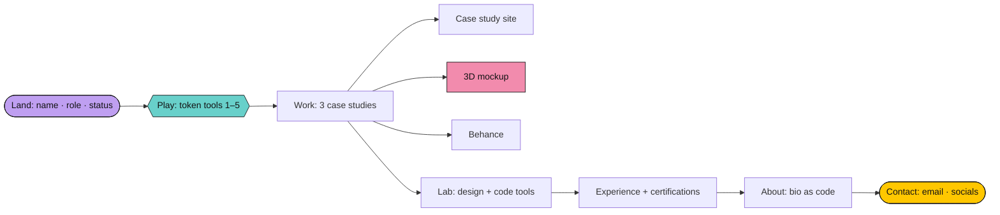

<br />

## 🗂️ Explore the sections

<details open>
<summary><b>Hero</b> — name, role, status and the token playground</summary>
<br />
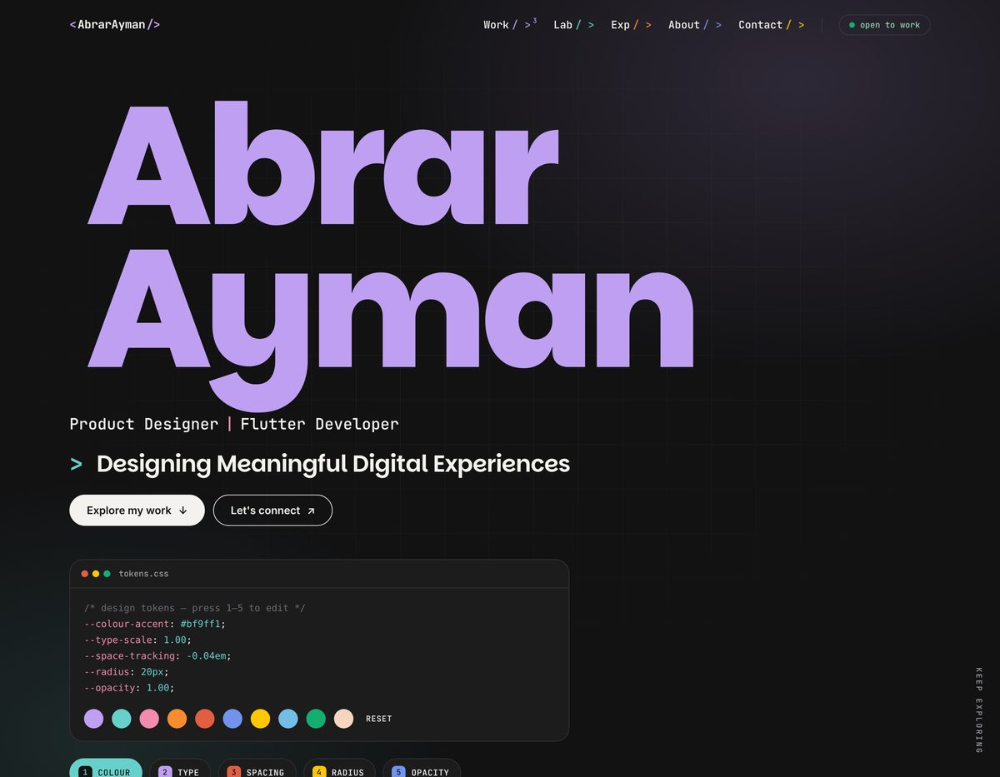

- Letters rise in one by one with a spring curve
- Hover or tap a letter to recolour it; the Colour tool recolours the whole name
- Page-load curtain wipes up in three layers
</details>

<details>
<summary><b>Work</b> — one section: case studies and projects together</summary>
<br />
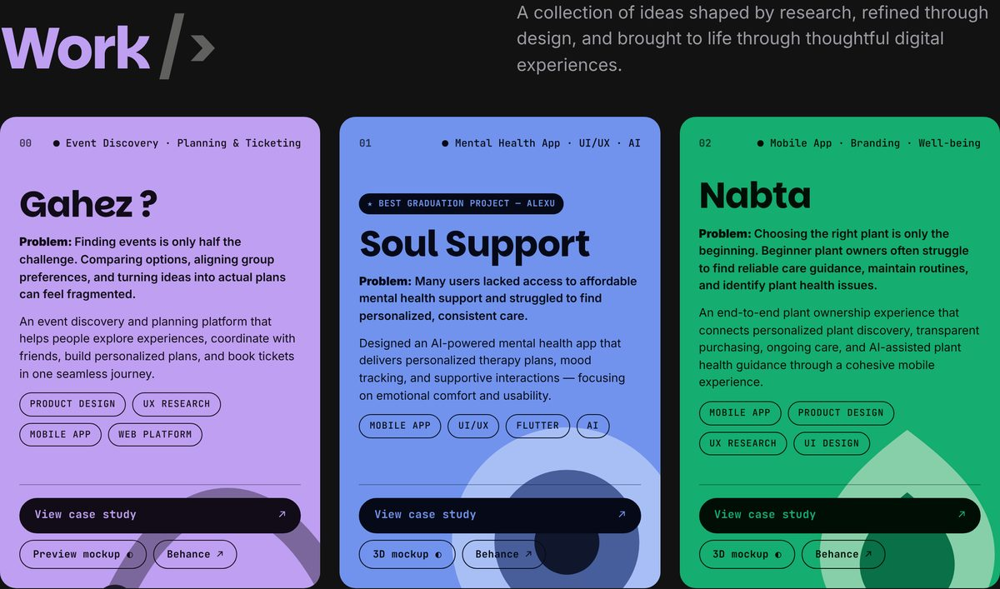

- Every project owns **one named hue**; card, ink and artwork all derive from it
- Each card leads with the **user problem**, then the solution, then three actions: **View case study**, **3D mockup**, **Behance**
- Featured: **Gahez** (event discovery and planning), **Soul Support** (AI mental-health app, *Best Graduation Project, Alexandria University*), **Nabta** (plant-ownership app)
</details>

<details>
<summary><b>3D mobile mockups</b> — drag-to-rotate phones with the real screens</summary>
<br />
<table>
  <tr>
    <td>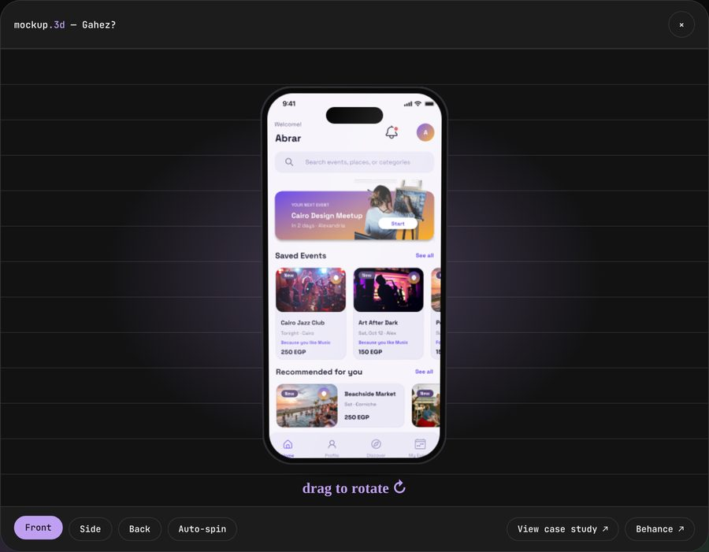</td>
    <td>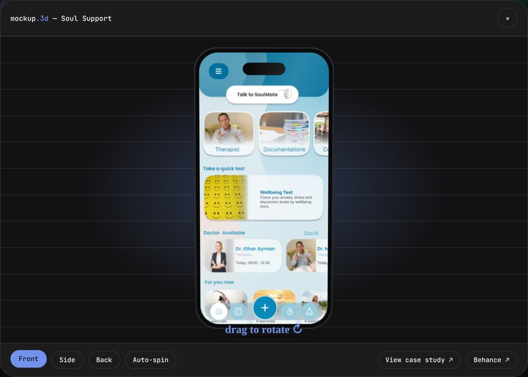</td>
    <td>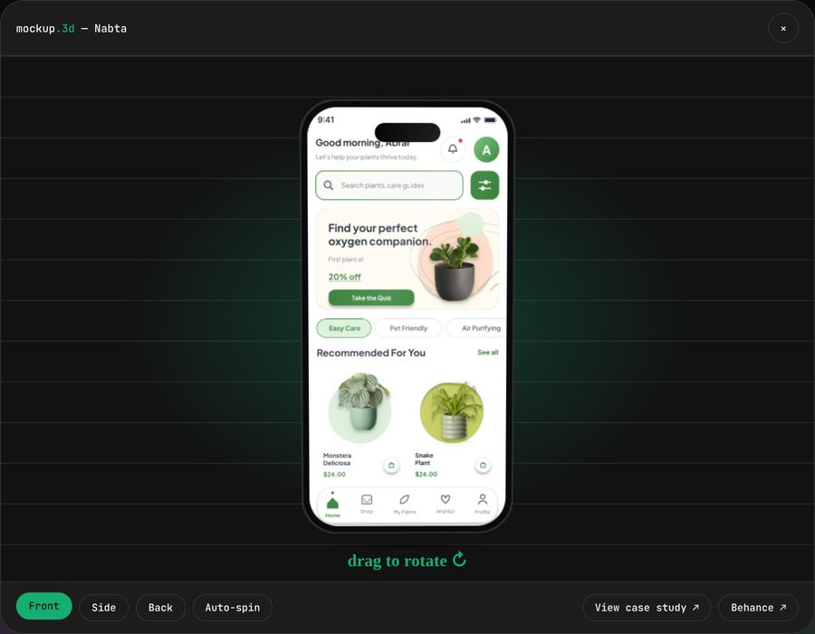</td>
  </tr>
  <tr align="center">
    <td><sub>Gahez</sub></td><td><sub>Soul Support</sub></td><td><sub>Nabta</sub></td>
  </tr>
</table>

- Built with **CSS 3D transforms** (stacked layers give the phone real thickness) and pointer events, with no 3D library
- Drag with inertia, snap to Front / Side / Back, toggle auto-spin
- A moving glare follows the rotation; native `<dialog>` handles focus and <kbd>Esc</kbd>
</details>

<details>
<summary><b>Lab · Experience · Certifications · About · Contact</b></summary>
<br />
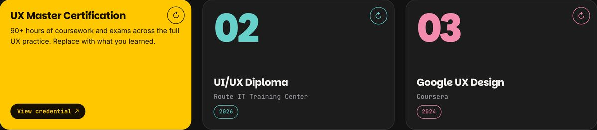

- **Lab:** two "window" panels, `designer.fig` and `developer.json`, listing the design and code toolkit
- **Experience:** a timeline with a colour per role
- **Certifications:** tilt + spotlight on hover, click to flip
- **About:** the bio written as a TypeScript class, syntax-highlighted by hand
- **Contact:** big type, one clear email link, social buttons that fill with their own hue
</details>

<details>
<summary><b>Mobile</b></summary>
<br />
<p align="center">
  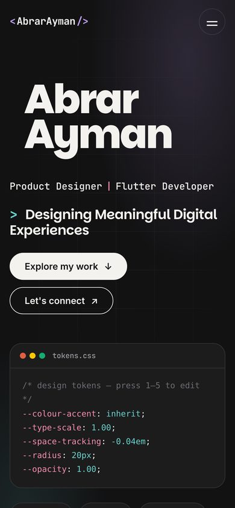
  &nbsp;&nbsp;
  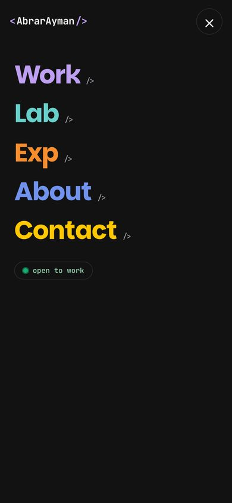
</p>

- Under 900 px the nav becomes a full-screen menu; under 640 px the grid is a single column
</details>

<br />

## 🎨 Design system

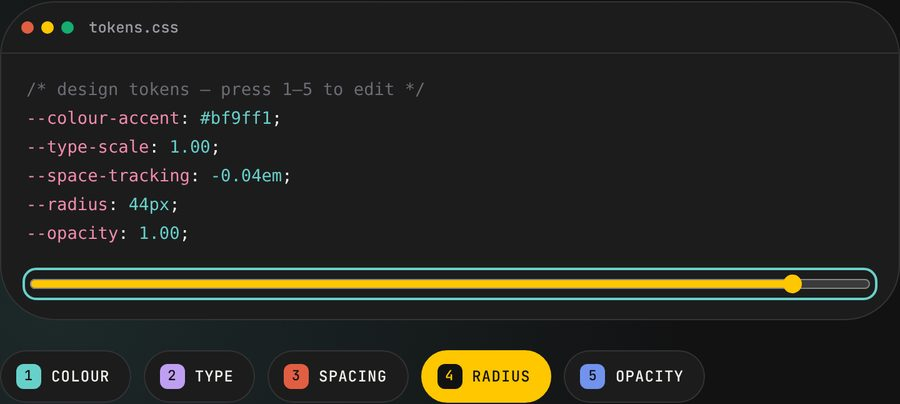

**Colour:** ten named hues, each with derived `-light`, `-dark` and `-deep` tones (40 colour tokens, all from `color-mix()` in OKLab).

| Token | Hex | Token | Hex |
|---|---|---|---|
| `quasar` | `#bf9ff1` | `tidal` | `#15ad70` |
| `pulsar` | `#68d0ca` | `orbit` | `#73bde7` |
| `corona` | `#f28bad` | `nebula` | `#7193ed` |
| `supernova` | `#f78d2c` | `solstice` | `#ffc700` |
| `flare` | `#e15e42` | `aurora` | `#f5d4c0` |

Surfaces: `#121213` · `#1c1c1d` · `#252527` · ink `#f4f2ee`

<br clear="right" />

| | |
|---|---|
| **Type** | Parkinsans (display) · Inter (body) · JetBrains Mono (labels, code) · Caveat (annotations) |
| **Spacing** | 8 · 12 · 16 · 24 · 32 · 48 · 72 · 120 px |
| **Radius** | `--radius: 20px` · `--radius-sm`: half of it · `--radius-pill: 999px` |
| **Motion** | `--ease: cubic-bezier(.22, 1, .36, 1)` · `--spring: cubic-bezier(.34, 1.56, .64, 1)` |

<br />

## ♿ Details that matter

- **Skip link** to main content, visible on focus
- **`:focus-visible`** rings on every interactive element
- **`prefers-reduced-motion`** respected: animations and transitions are effectively switched off
- Token tools are a real `role="toolbar"` with `aria-pressed` and `aria-keyshortcuts`
- Flippable cards use `inert` on the hidden face so keyboard focus never lands on it
- Meaningful `aria-label`s on icon-only buttons; decorative art is `aria-hidden`

> I haven't run a formal WCAG audit yet, so I don't claim compliance. It's on the list below.

<br />

## 🛠️ Built with

`HTML5` · `CSS custom properties` · `color-mix()` · `CSS 3D transforms` · `<dialog>` · `IntersectionObserver` · vanilla `JavaScript` · Google Fonts

No framework, no bundler, no dependencies. The whole site is **one `index.html`** plus the three app screens.

```text
.
├── index.html     ← the entire site: tokens, layout, interactions
├── soul.png       ← app screens used by the 3D mockups
├── gahez.svg
├── nabta.svg
└── assets/        ← README media only (banner, demo recording, screenshots)
```

Modern evergreen browsers are required (`color-mix()`: Chrome 111+, Safari 16.2+, Firefox 113+).

<br />

## 🚀 Run it locally

```bash
git clone https://github.com/Abrarayman27/Abrar_UI-UX_portfolio.git
cd Abrar_UI-UX_portfolio

# just open it…
open index.html            # macOS  (Windows: start index.html)

# …or serve it
python3 -m http.server 8000   # → http://localhost:8000
```

<details>
<summary><b>Make it yours: add a project in 60 seconds</b></summary>
<br />

Copy any `<div class="reveal" data-item>` card inside `#workCards`, paste it after the last one, then change:

```html
<article class="pr-card" style="--card-bg:var(--colour-pulsar);--card-ink-deep:var(--colour-pulsar-deep)">
  <!-- hue: quasar · pulsar · corona · supernova · flare · nebula · solstice · orbit · tidal · aurora -->
  ...
  <a class="act act--main" href="https://your-case-study.com" target="_blank" rel="noopener noreferrer">View case study ↗</a>
  <button class="act" data-mockup
          data-title="Project name" data-hue="pulsar"
          data-screen="your-screen.png"
          data-case="https://your-case-study.com"
          data-behance="https://www.behance.net/gallery/...">3D mockup</button>
</article>
```

The nav counter, scroll reveal and 3D viewer pick the new card up automatically. Swap colours globally by editing the ten `--colour-*` values at the top of the `<style>` block.
</details>

<br />

## 🔭 What I'd do next

- [ ] Run an accessibility audit (contrast, keyboard flow, screen readers)
- [ ] Add a light theme (the tokens are ready for it)
- [ ] Replace remaining placeholder content with final case-study imagery
- [ ] Test with real visitors: do the token tools get noticed, and does the 3D mockup lead people into a case study?

<br />

## 🙌 Credits

- Fonts: [Parkinsans](https://fonts.google.com/specimen/Parkinsans), [Inter](https://rsms.me/inter/), [JetBrains Mono](https://www.jetbrains.com/lp/mono/), [Caveat](https://fonts.google.com/specimen/Caveat), all open-source (SIL OFL)
- App screens, case studies and copy © Abrar Ayman. Please ask before reusing them. (Add a `LICENSE` file if you'd like to open-source the code.)

<br />

## 📬 Let's talk

<div align="center">

**Open to full-time roles, freelance projects and collaborations in product design and Flutter development.**

[abrarayman81@gmail.com](mailto:abrarayman81@gmail.com) · [LinkedIn](https://www.linkedin.com/in/abrar-ayman) · [Behance](https://www.behance.net/abrarayman2) · [GitHub](https://github.com/Abrarayman27)

<br />

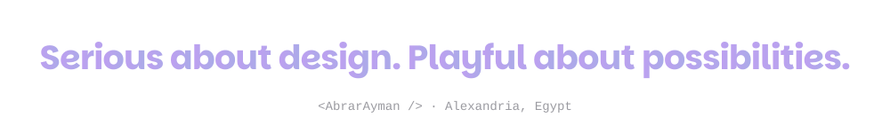

</div>
